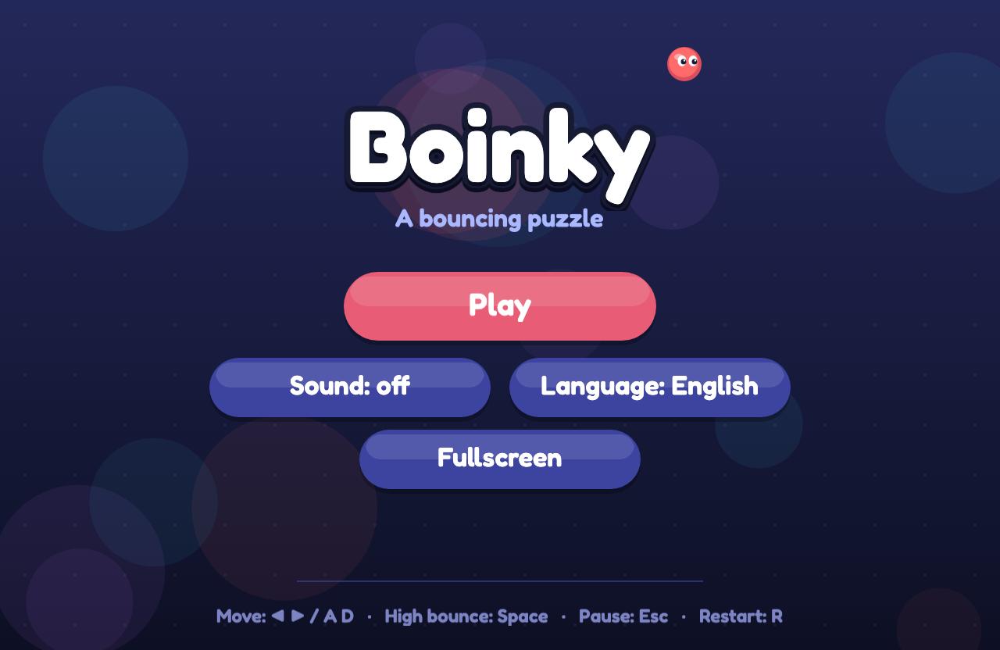
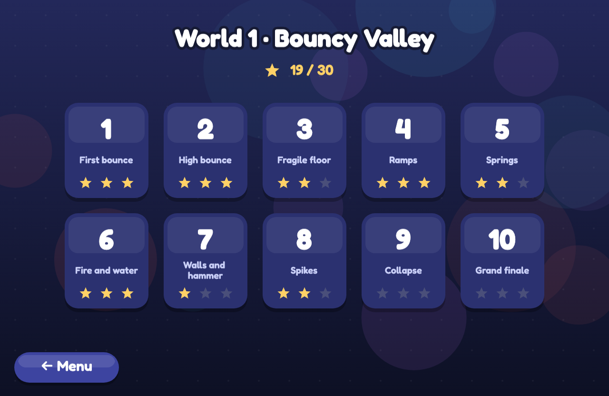
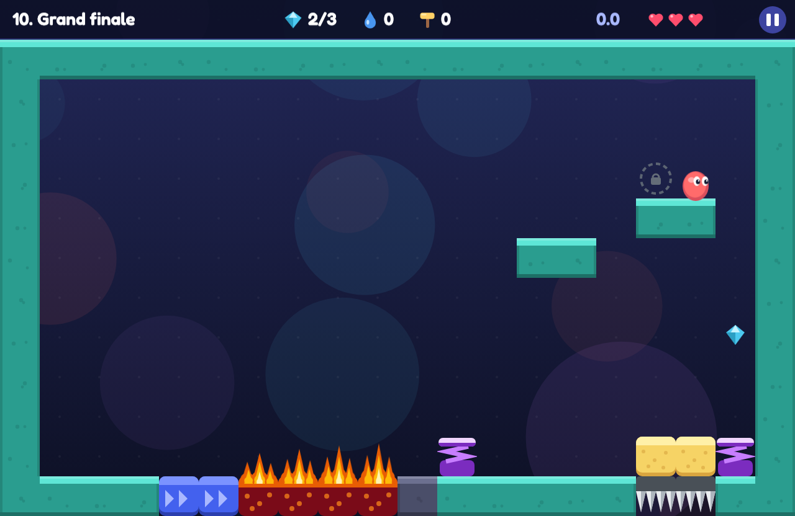

# Boinky

**A bouncing-ball puzzle game for desktop, tablet and phone.** The ball never stops bouncing:
steer it, time your high bounces, collect every gem and reach the exit. Free, no sign-up, in
English, Spanish and Portuguese. Installs as an app and plays offline.

[](https://github.com/mtorre4580/boinky/actions/workflows/ci.yml)


<sub>Recorded from the game: the automatic solver playing levels 4 and 10.
[Watch it as a video](docs/media/demo.mp4).</sub>

## How it works

1. **Bounce.** The ball bounces on its own. Move it with ◀ ▶ and hold **jump** as it lands for a
   high bounce that climbs three blocks instead of one.
2. **Collect.** Grab every gem in the level to open the exit. Power-ups work on their own: a water
   drop puts out fire, a hammer knocks down a whole brick wall.
3. **Escape.** Reach the exit before you run out of lives. Each level gives up to three stars:
   finish it, lose no lives and beat the par time.

<table>
  <tr>
    <td width="33%"></td>
    <td width="33%"></td>
    <td width="33%"></td>
  </tr>
  <tr>
    <td align="center">Menu</td>
    <td align="center">World 1</td>
    <td align="center">Grand finale</td>
  </tr>
</table>

### On your phone

Open it in the browser and add it to your home screen: it installs as an app (PWA), opens in full
screen and works offline. The touch controls sit beside the level, never on top of it.


## Features

- **10 levels** in World 1, each teaching one idea: high bounces, fragile floors, ramps, springs,
  fire and water, walls and hammers, spikes, and a grand finale that mixes them all.
- **Solvable by construction**: an automatic solver plays every level with the real physics in CI,
  so no level ships without a proven solution.
- **Keyboard, touch and gamepad**, with menus you can drive from any of them.
- **Three languages**: English, Spanish and Brazilian Portuguese, picked from the browser and
  switchable in the menu.
- **Installable and offline**: a PWA with a service worker that precaches the whole game.
- **No assets to download**: graphics are drawn with vectors and sounds are synthesized with the
  Web Audio API. Progress is saved in `localStorage`.

## Built with

TypeScript, Phaser 3 (Canvas renderer), Vite and vite-plugin-pwa. Tests with Vitest, Playwright
and axe; Lighthouse CI scores 100 in performance, accessibility, best practices and SEO.

## Development

Requires Node 24 (see `.nvmrc`) and pnpm.

```bash
pnpm install
pnpm dev
```

| Command | What it does |
|---|---|
| `pnpm dev` | Development server (add `?level=5` to open a level directly) |
| `pnpm build` | Typecheck + production build with the service worker |
| `pnpm preview` | Serves the build |
| `pnpm test` / `pnpm test:run` | Vitest (watch / once) |
| `pnpm lint` / `pnpm typecheck` | ESLint / `tsc --noEmit` |
| `pnpm validate:levels` | Parses every level, checks its texts in all languages and proves it is solvable |
| `pnpm check:bundle` | Gzip budget per chunk (after `pnpm build`) |
| `pnpm test:e2e` | Playwright + axe on desktop and phone (after `pnpm build`) |
| `pnpm lhci` | Lighthouse CI on the built game |
| `pnpm media` | Regenerates the README screenshots, GIF and video (needs ffmpeg) |
| `pnpm icons` | Regenerates the app icons in `public/icons` |

In development, the browser console has `await replay(3)` (fast-forwards the solver's solution for
level 4) and `demo(3)` (plays it in real time).

## Deploy

The build in `dist/` is a static site with relative paths, so it works from any folder.
`.github/workflows/deploy.yml` publishes it to GitHub Pages after CI passes on `main`; it stays
idle while the repository is private.

## Contributing

Read [`CONTRIBUTING.md`](./CONTRIBUTING.md) to get started, and [`CLAUDE.md`](./CLAUDE.md) for the
full technical context and conventions.

## License

All rights reserved. This is a private project for now.
