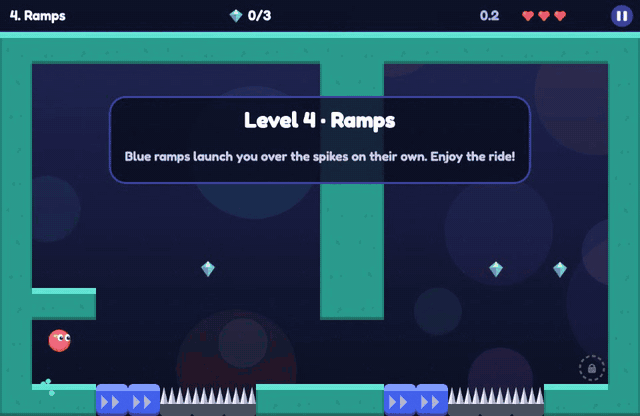
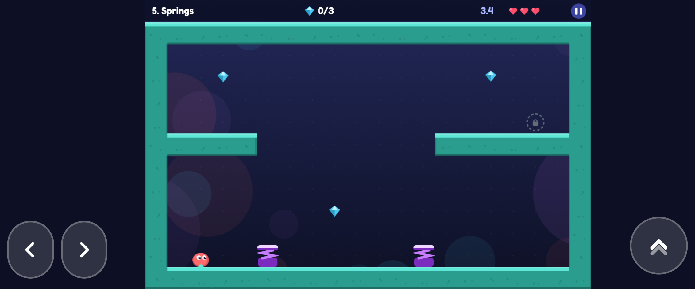

# Pongui

**A bouncing-ball puzzle game for desktop, tablet and phone.** The ball never stops bouncing:
steer it, time your high bounces, collect every gem and reach the exit. 100 levels in 10 worlds
and a level editor. Free, no sign-up, in English, Spanish and Portuguese. Installs as an app and
plays offline.

### ▶ [Play it at pongui.com](https://pongui.com/?utm_source=github)

| | |
|---|---|
| **Play** | [pongui.com](https://pongui.com/?utm_source=github) · [itch.io](https://pongui.itch.io/pongui) |
| **Watch** | [YouTube](https://www.youtube.com/@playpongui) · [Instagram](https://www.instagram.com/playpongui/) |
| **Contact** | hello@pongui.com |

[](https://github.com/mtorre4580/pongui/actions/workflows/ci.yml)



<sub>Recorded from the game: the automatic solver playing levels 4 and 10.
[Watch it as a video](docs/media/demo.mp4).</sub>

## How it works

1. **Bounce.** The ball bounces on its own. Move it with ◀ ▶ and hold **jump** as it lands for a
   high bounce that climbs three blocks instead of one.
2. **Collect.** Grab every gem in the level to open the exit. Power-ups work on their own: a water
   drop puts out fire, a hammer knocks down a whole brick wall.
3. **Escape.** Reach the exit before you run out of lives. Each level gives up to three stars:
   finish it, lose no lives and beat the par time.

<table>
  <tr>
    <td width="33%"></td>
    <td width="33%"></td>
    <td width="33%"></td>
  </tr>
  <tr>
    <td align="center">Menu</td>
    <td align="center">World 1</td>
    <td align="center">Grand finale</td>
  </tr>
</table>

### On your phone

Open it in the browser and add it to your home screen: it installs as an app (PWA), opens in full
screen and works offline. There are no on-screen buttons: slide a finger anywhere to steer, and
double tap (or rest a second finger) to bounce higher.



## Landing page

The site root is a landing page that presents the game: a hero video, how to play, a clip for
every world (recorded from the game with the solver at the controls), the level editor, the devices it runs on,
install instructions and an FAQ, in the same three languages. The game lives at
`/play/`, which is also where the installed app opens. The landing page is plain HTML, CSS and a
small script (~15 KB gzip on first load); videos load only when they scroll into view and can
always be paused.

## iOS and Android apps

The same game ships as native apps through [Capacitor](https://capacitorjs.com): the build is
packaged inside an iOS (Xcode) and an Android (Android Studio) project, so the app works offline
from the first launch and needs no website. Inside the app the game opens directly, saves
progress in native storage, hides the system bars, locks landscape and adds haptic feedback.

```bash
pnpm build:native   # build the game for the apps and sync it into ios/ and android/
pnpm ios            # open the iOS project in Xcode
pnpm android        # open the Android project in Android Studio
```

Requires Xcode for iOS and Android Studio (with its JDK) for Android. Icons and splash screens
come from `assets/` (`pnpm icons` then `pnpm native:assets`).

## Features

- **100 levels in ten worlds**, each level teaching one idea. Bouncy Valley brings high bounces,
  fragile floors, ramps, springs, fire and water, walls and hammers and spikes; Crystal Caves adds
  keys that open lock blocks and soft moss that never bounces you high; Cloud Peaks adds one-way
  clouds and updrafts that lift you; Gear Works adds switches that swap orange and teal blocks
  and pushers that throw you sideways; Coral Lagoon adds paired portals and water where you sink
  slowly and bounce higher; Frost Peaks adds slippery ice and thin ice that cracks under a high
  bounce; Ember Core adds crumbling rock and lava vents that blaze on a rhythm; Star Station adds
  low-gravity zones and bumpers that throw you back; Shadow Keep turns off the lights and adds
  blocks that phase in and out; Rainbow Summit adds rainbow bridges that appear once you hold
  every gem, and remixes everything for the finale.
- **Solvable by construction**: an automatic solver plays every level with the real physics in CI,
  so no level ships without a proven solution.
- **Ten balls to choose from**, opened with the stars you earn: a reason to go back for the ones
  you missed. They change the look, not the game.
- **Level editor** (on a computer): paint levels with every tile of the ten worlds, test them, and
  share them once both the solver and you have beaten them. A shared level travels inside its
  link (no server): copy it, send it by WhatsApp or scan its QR code with a phone to play it there.
  "My levels" keeps your levels and the ones shared with you, on any device.
- **Keyboard, touch gestures and gamepad**, with menus you can drive from any of them.
- **Three languages**: English, Spanish and Brazilian Portuguese, picked from the browser and
  switchable in the menu.
- **Installable and offline**: a PWA with a service worker that precaches the whole game.
- **No assets to download**: graphics are drawn with vectors and sounds are synthesized with the
  Web Audio API. Progress is saved in `localStorage`.

## Built with

TypeScript, Phaser 3 (Canvas renderer), Vite and vite-plugin-pwa; QR codes with
qrcode-generator. Tests with Vitest, Playwright
and axe; Lighthouse CI scores 100 in performance, accessibility, best practices and SEO.

## Development

Requires Node 24 (see `.nvmrc`) and pnpm.

```bash
pnpm install
pnpm dev
```

| Command | What it does |
|---|---|
| `pnpm dev` | Development server: landing page at `/`, game at `/play/` (`/play/?level=5` opens a level) |
| `pnpm build` | Typecheck + production build with the service worker |
| `pnpm preview` | Serves the build |
| `pnpm test` / `pnpm test:run` | Vitest (watch / once) |
| `pnpm lint` / `pnpm typecheck` | ESLint / `tsc --noEmit` |
| `pnpm validate:levels` | Parses every level, checks its texts in all languages and proves it is solvable |
| `pnpm check:bundle` | Gzip budget per chunk (after `pnpm build`) |
| `pnpm test:e2e` | Playwright + axe on desktop and phone (after `pnpm build`) |
| `pnpm lhci` | Lighthouse CI on the built game |
| `pnpm media` | Regenerates the README media, the landing page videos and screenshots, and the social image (needs ffmpeg) |
| `pnpm media:social` | Records vertical videos for Instagram, TikTok and YouTube Shorts into `docs/social/` (not committed) |
| `pnpm icons` | Regenerates the web app icons in `public/icons` and the native sources in `assets/` |
| `pnpm build:native` | Builds the game for the iOS/Android apps and syncs it into `ios/` and `android/` |
| `pnpm build:itch` | Builds the game alone into `dist-itch/` and zips it as `pongui-itch.zip`, ready to upload to itch.io as an HTML game |
| `pnpm native:assets` | Generates every iOS and Android icon and splash size from `assets/` |

In development, the browser console has `await replay(3)` (fast-forwards the solver's solution for
level 4) and `demo(3)` (plays it in real time).

## Deploy

The build in `dist/` is a static site with relative paths, so it works from any folder. Set the
public URL in `.env` (`VITE_SITE_URL`) for the canonical link, Open Graph and structured data.
`robots.txt` and `sitemap.xml` are written from the same variable at build time.

`.github/workflows/deploy.yml` publishes `dist/` to [Cloudflare Pages](https://pages.cloudflare.com)
after CI passes on `main` (free, works with a private repository, custom domain with HTTPS). It
stays idle until the repository has:

| Kind | Name | Value |
|---|---|---|
| Variable | `CLOUDFLARE_PAGES_PROJECT` | Name of the Pages project (created once with "Direct upload") |
| Variable | `SITE_URL` | Public address, shown on the deployment |
| Variable | `UMAMI_WEBSITE_ID` | Optional: Umami website id for anonymous statistics |
| Secret | `CLOUDFLARE_API_TOKEN` | API token with the "Cloudflare Pages: Edit" permission |
| Secret | `CLOUDFLARE_ACCOUNT_ID` | Account id from the Cloudflare dashboard |

Usage statistics are optional: set the repository variable `UMAMI_WEBSITE_ID` (an
[Umami Cloud](https://umami.is) website id) and the build loads its cookieless tracker; without
it nothing is loaded. What is measured is listed in `/privacy/`.

`public/_headers` sets the cache rules (hashed assets forever, the service worker never) and
`public/404.html` is the "not found" page.

## Contributing

Read [`CONTRIBUTING.md`](./CONTRIBUTING.md) to get started, and [`CLAUDE.md`](./CLAUDE.md) for the
full technical context and conventions.

## License

All rights reserved: see [`LICENSE`](./LICENSE). The code is public to be read and improved, not
to be reused: you may study it and send pull requests, but not publish the game, a modified
version of it, or its code, levels, art, sounds or name elsewhere.
